# DIGGER

**Windmill Software, 1983**, ported from the original C and 8088 assembler sources to plain browser JavaScript.

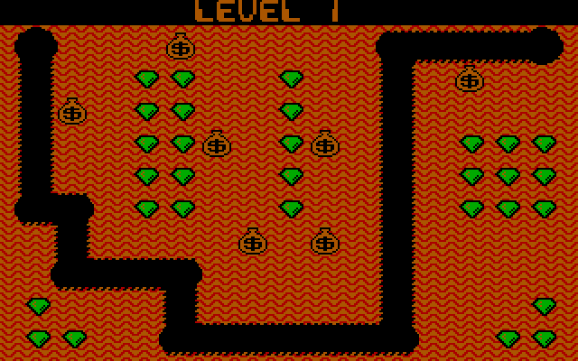

To play, open `index.html` in a browser, or publish the repository with GitHub Pages
(Settings → Pages → deploy from the main branch, root folder). There is no build step and there are no dependencies.

---

## How to play

You drive the **Digger Mobile** through an underground mine. Tunnel through the dirt, scoop up every emerald,
and keep away from the Nobbins and Hobbins that pour out of the top-right corner. Gold sacks sit in the dirt above you:
dig out from under one and it wobbles, then falls. It squashes anything below it, and if it falls more than one row
it bursts open into gold you can collect.

You clear a round by collecting all the emeralds *or* by getting rid of every monster in the round. Once the last
monster has come out, a **cherry** appears where they emerged. Eat it and the screen changes colour, the monsters
run away from you, and for a short time you can eat them for big points.

### Keys

| Key | Action |
| --- | --- |
| <kbd>←</kbd> <kbd>→</kbd> <kbd>↑</kbd> <kbd>↓</kbd> | Drive the Digger (the numeric keypad works too) |
| <kbd>F1</kbd> or <kbd>Z</kbd> / <kbd>Enter</kbd> | Throw a fireball in the direction you face |
| <kbd>Space</kbd> | Pause; any key resumes |
| <kbd>F7</kbd> | Background music on/off |
| <kbd>F9</kbd> | All sound on/off |
| <kbd>Esc</kbd> | On the title screen: toggle 1 or 2 players |
| any other key | On the title screen: start the game |

Your browser may grab <kbd>F1</kbd> for its own help page, so <kbd>Z</kbd> and <kbd>Enter</kbd> also fire.
The web page only takes the keys while the game screen is mostly in view, so you can still scroll down and read.
Under the screen there are also buttons for music and sound, a volume slider, a speed control, a starting-level selector and full screen.

### Scoring

| Event | Points |
| --- | ---: |
| Nobbin or Hobbin (fireball or falling gold) | 250 |
| Emerald | 25 |
| Gold from a burst sack | 500 |
| Eight emeralds in a row | +250 |
| Cherry | 1000 |
| Monsters eaten in bonus mode | 200, 400, 800… |

You earn an extra life every **20,000** points, up to five lives. High scores are saved in your browser,
where the original wrote them to its floppy disk.

### Tips from the original instructions

> “During normal play, you destroy Nobbins & Hobbins with your fireball or by pushing the gold sacks down a mine
> shaft. Don't forget to scoop up the gold when the sack breaks. After all the Nobbins & Hobbins have emerged,
> cherries appear. Scooping up the cherries begins a bonus round.”
>
> — the in-game instructions screen from the shareware build (`TZ.C`)

- You can push a gold sack sideways by driving into it, and push a whole row of sacks along together.
- A sack falling down a shaft takes out every monster in its path, at 250 each.
- The Digger's red cab disappears after you throw a fireball. When it comes back, the fireball has recharged.
- Monsters that keep getting blocked lose patience and become **Hobbins**, which dig straight towards you.
- Eating emeralds one after another, without a pause, plays a rising scale. The eighth note pays the 250 bonus.

---

## How DIGGER works

To port the game I had to read every line of the original, so here is what I found. Everything below comes from the
1983 sources (`TA.C`–`TZ.C`, `GRAPHLIB.ASM`, `KEYBOARD.ASM`, the `.SPR` sprite files and the `.CHR` font).
The sprites, maps and screenshots are drawn from the original data by this port's own engine.

1. [Program structure](#1-program-structure)
2. [The CGA display](#2-the-cga-display)
3. [Sprites](#3-sprites)
4. [The sprite engine and collisions](#4-the-sprite-engine-and-collisions)
5. [The playfield grid](#5-the-playfield-grid)
6. [Level structure](#6-level-structure)
7. [How tunnels are remembered](#7-how-tunnels-are-remembered)
8. [Nobbins and Hobbins: the enemy AI](#8-nobbins-and-hobbins-the-enemy-ai)
9. [Difficulty table](#9-difficulty-table)
10. [Gold sacks](#10-gold-sacks)
11. [The Digger and its fireball](#11-the-digger-and-its-fireball)
12. [Bonus mode](#12-bonus-mode)
13. [Scores, lives and two players](#13-scores-lives-and-two-players)
14. [Keeping a constant speed](#14-keeping-a-constant-speed)
15. [Two voices from one beeper](#15-two-voices-from-one-beeper)
16. [The title screen](#16-the-title-screen)
17. [Quirks and curiosities](#17-quirks-and-curiosities)
18. [About this port](#18-about-this-port)

## 1. Program structure

The game is written in Lattice C with a small library of 8088 assembler for graphics, keyboard and copy protection.
Each source file is one "task", identified by a letter:

| File | Task |
| --- | --- |
| `TZ.C` | Main program: title screen and demo, game loop, levels, players, pause |
| `TA.C` | Nobbins and Hobbins: spawning, AI, dying |
| `TB.C` | Gold sacks: loosening, wobbling, falling, pushing, bursting |
| `TC.C` | The Digger: movement, death sequence, fireball, bonus cherry |
| `TD.C` | Emeralds: placement and eating |
| `TE.C` | Joystick/keyboard reading |
| `TF.C` | Scores, extra lives, high-score table and initials entry |
| `TG.C` | Background: dirt patterns and the tunnel bitmap |
| `TH.C` | Sound: the timer interrupt, music and every sound effect |
| `TX.C` | Data: the eight level maps and a 256-entry random table |
| `IMAGE.C`, `IMAGE_B.C` | Animation: picking sprite frames for each object |
| `GRAPHLIB.ASM` | The sprite engine (save-under, masking, collision detection) |

Each frame, the main loop calls `task_c()` (Digger), then `task_a()` (monsters), then `task_b()` (sacks).
It then waits out the rest of the frame and checks for pause and end of round. Sound runs separately,
inside a reprogrammed timer interrupt.

## 2. The CGA display

DIGGER runs in CGA mode 4: 320×200 pixels, 4 colours, 2 bits per pixel, four pixels per byte with the leftmost in
the high bits. Video memory is *interlaced*: even lines start at `B800:0000` and odd lines at `B800:2000`,
80 bytes per line. Every routine in `GRAPHLIB.ASM` steps through those two banks by hand.

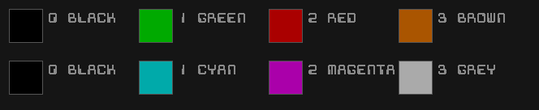

*Top row: palette 0, used for normal play. Bottom row: palette 1, used in bonus mode.*

Bonus mode doesn't redraw anything. It writes one bit to the CGA colour-select register (port `3D9h`) and the whole
mine instantly changes from green/red/brown to cyan/magenta/grey:

| Level 1, palette 0 | The same screen memory shown with palette 1 |
| --- | --- |
|  | 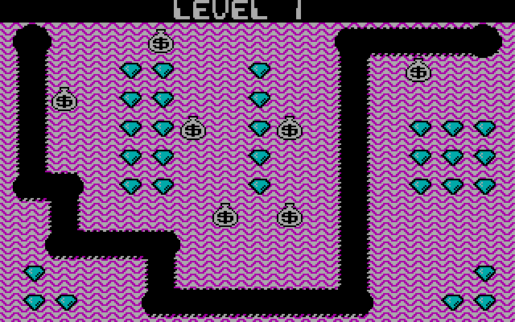 |

Text uses its own 39-glyph font (`CHAR__*.CHR`), 3 bytes (12 px) wide. A glyph is ANDed with the colour repeated
across the byte, so one bitmap can be drawn in any of the four colours:

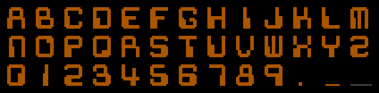

## 3. Sprites

The 77 sprites were drawn in a home-made editor, `SPGEN.BAS` (GW-BASIC). It writes each one out as a C header with a
32×32 picture in a comment, an `image_` array, an `outln_` (mask) array and the width and height. In the editor,
colour 4 means "transparent": it becomes image `00` with outline `11`, so the background shows through. Most actors are
4 bytes × 15 lines (16×15 pixels). In the images below, the dark grey is the transparent area and black is real black.

**Digger, moving right / left / up / down (three frames each)**

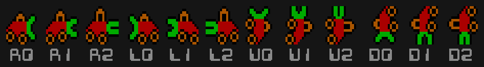

**Digger with the fireball spent ("no cab"), shown while recharging**

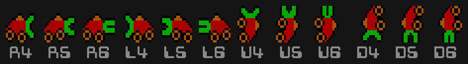

**Death: overturned digger, then the gravestone rising**

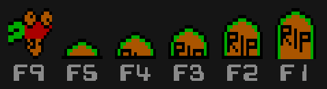

**Nobbin (three frames) and squashed Nobbin**

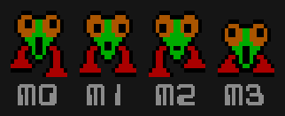

**Hobbin facing right, then left (three frames + squashed)**

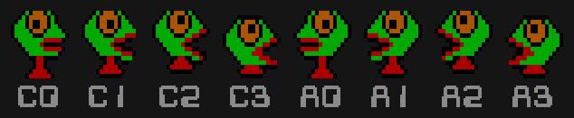

**Gold bag: resting, wobbling, falling, bursting**

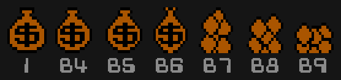

| Emerald and its erase block | Fireball in flight, then exploding | Bonus cherry | Lives indicator: player 1, player 2, blank |
| --- | --- | --- | --- |
| 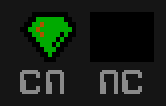 | 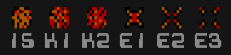 | 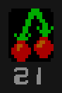 | 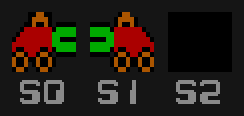 |

**Tunnel "bite" blanks (right, left, up, down) and bag-fall blanks**

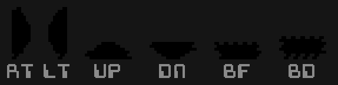

**Dirt patterns for levels 1–8 (5×4 bytes, tiled)**

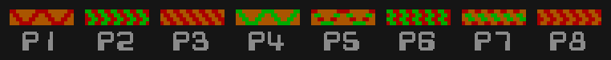

**Placeholder / spare images**

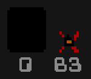

The same pixels in the bonus palette:

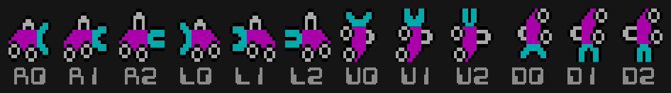
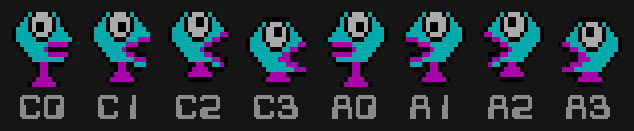

The animation code in `IMAGE.C` cycles the three walking frames 0→1→2→1→0… by flipping an increment.
There is no frame timer: each call to `draw_bug()` or `draw_man()` advances one frame.

## 4. The sprite engine and collisions

`GRAPHLIB.ASM` manages 16 hardware-less sprites. Each one has an image, a mask, a save-under buffer, a position and an
"active" flag. Drawing a sprite works like this:

1. Save the screen bytes underneath into the sprite's background buffer.
2. AND the mask into the screen, then OR the image on top.

When a sprite moves, the engine first works out every active sprite that overlaps the old or new position. It repeats
this recursively, so a chain of touching sprites is all collected. It erases them all in reverse order, restoring their
saved backgrounds, then redraws them in a fixed priority order, so overlapping sprites never leave garbage behind.
The draw order is:

```
table[] = { 14, 13, 7, 6, 5, 4, 3, 2, 1, 12, 11, 10, 9, 8, 15, 0 }
            cherry, monster 13, sacks 7..1, monsters 12..8, fireball, and the Digger (0) last, on top
```

The sprite slots are fixed for the whole game:

| Slot | Object | Collision bit |
| --- | --- | --- |
| 0 | Digger | `0x0001` |
| 1–7 | Gold sacks | `0x00FE` |
| 8–13 | Nobbins / Hobbins (max 6) | `0x3F00` |
| 14 | Bonus cherry | `0x4000` |
| 15 | Fireball | `0x8000` |

`sp_move()` returns a 16-bit mask of which other sprites the moved sprite now overlaps. The game logic uses nothing
else to decide what hit what. For example, in `TA.C`:

```c
if(bug[bug_num][BUG_TYPE]==NORMAL && (colision & 0x3f00) && get_m_ststus() )
	bug[bug_num][BUG_STUCK]++;
```

Collisions are bounding boxes only, which is why the fireball and monsters can seem to hit from a pixel or two away.
There's one subtle detail: at x+320/y−2 a sprite lands on the same video memory as x/y (the next interlaced line
starts 80 bytes later). So the engine also tests those "wrapped" positions, which keeps sprites near the right-hand
edge erasing correctly.

## 5. The playfield grid

The mine is a **15 × 10 grid** of cells, each 20 pixels wide and 18 high, with its top-left at (12, 18).
The top 18 pixel rows hold the scores and lives.

- The Digger and the monsters move 4 px horizontally or 3 px vertically per step. That is 5 steps to cross a column and 6 to cross a row.
- They can only turn when they are exactly on a cell boundary. If you press a perpendicular arrow between cells, the
  Digger keeps going until it reaches the next boundary and then turns. This "pre-turn" makes the controls feel forgiving.
- The Digger always starts at cell (7, 9), bottom centre. Monsters always come out at (14, 0), top right.

## 6. Level structure

There are eight hand-made screens. Each is a 10-row × 15-column array of characters in `TX.C`:

| Char | Meaning |
| --- | --- |
| `S` | Solid open cell (the tunnel occupies the whole cell) |
| `H` | Horizontal tunnel through the cell |
| `V` | Vertical tunnel through the cell |
| `C` | Emerald (C for "coin", the name used throughout the code) |
| `B` | Gold sack ("money bag") |
| space | Untouched dirt (shown as `.` in the maps below) |

The level number keeps going up, but the screen shown follows this function from `TZ.C`:

```c
get_screen()
{
	int	temp;
	temp=get_level();
	if(temp>8)
		temp=(temp%4)+5;	/* rotate through the last 4 screens */
	return(temp);
}
```

So the sequence is 1 2 3 4 5 6 7 8, then **6 7 8 5 6 7 8 5 …** forever. Note the 9th screen is screen 6, not 5.
Difficulty is `min(level, 10)`, so from level 10 on, only the screens change. Each screen also chooses one of eight
dirt patterns.

<table>
<tr>
<td width="50%"><br><b>Screen 1</b>
<pre>
S...B.....HHHHS
V..CC..C..V.B..
VB.CC..C..V....
V..CCB.CB.V.CCC
V..CC..C..V.CCC
HH.CC..C..V.CCC
.V....B.B.V....
.HHHH.....V....
C...V.....V...C
CC..HHHHHHH..CC
</pre></td>
<td width="50%">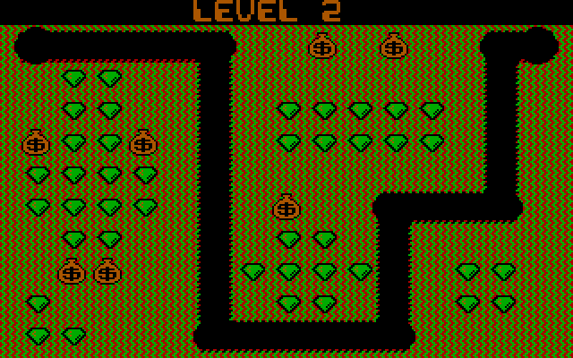<br><b>Screen 2</b>
<pre>
SHHHHH..B.B..HS
.CC..V.......V.
.CC..V.CCCCC.V.
BCCB.V.CCCCC.V.
CCCC.V.......V.
CCCC.V.B..HHHH.
.CC..V.CC.V....
.BB..VCCCCV.CC.
C....V.CC.V.CC.
CC...HHHHHH....
</pre></td>
</tr>
<tr>
<td>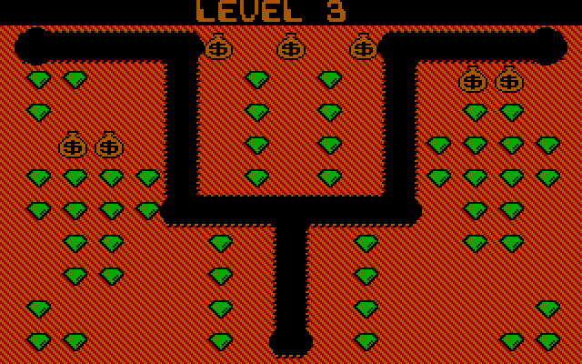<br><b>Screen 3</b>
<pre>
SHHHHB.B.BHHHHS
CC..V.C.C.V.BB.
C...V.C.C.V.CC.
.BB.V.C.C.VCCCC
CCCCV.C.C.VCCCC
CCCCHHHHHHH.CC.
.CC..C.V.C..CC.
.CC..C.V.C.....
C....C.V.C....C
CC...C.H.C...CC
</pre></td>
<td>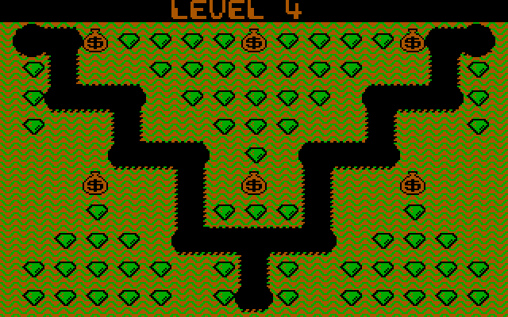<br><b>Screen 4</b>
<pre>
SHBCCCCBCCCCBHS
CV..CCCCCCC..VC
CHHH.CCCCC.HHHC
C..V..CCC..V..C
...HHH.C.HHH...
..B..V.B.V..B..
..C..VCCCV..C..
.CCC.HHHHH.CCC.
CCCCC.CVC.CCCCC
CCCCC.CHC.CCCCC
</pre></td>
</tr>
<tr>
<td>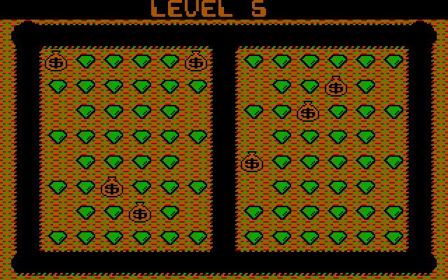<br><b>Screen 5</b>
<pre>
SHHHHHHHHHHHHHS
VBCCCCBVCCCCCCV
VCCCCCCV.CCBC.V
V.CCCC.VCCBCCCV
VCCCCCCV.CCCC.V
V.CCCC.VBCCCCCV
VCCBCCCV.CCCC.V
V.CCBC.VCCCCCCV
VCCCCCCVCCCCCCV
HHHHHHHHHHHHHHH
</pre></td>
<td>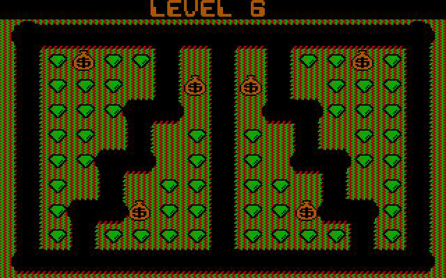<br><b>Screen 6</b>
<pre>
SHHHHHHHHHHHHHS
VCBCCV.V.VCCBCV
VCCC.VBVBV.CCCV
VCCCHH.V.HHCCCV
VCC.V.CVC.V.CCV
VCCHH.CVC.HHCCV
VC.V.CCVCC.V.CV
VCHHBCCVCCBHHCV
VCVCCCCVCCCCVCV
HHHHHHHHHHHHHHH
</pre></td>
</tr>
<tr>
<td>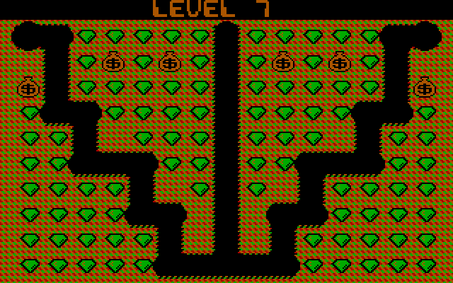<br><b>Screen 7</b>
<pre>
SHCCCCCVCCCCCHS
.VCBCBCVCBCBCV.
BVCCCCCVCCCCCVB
CHHCCCCVCCCCHHC
CCV.CCCVCCC.VCC
CCHHHCCVCCHHHCC
CCCCV.CVC.VCCCC
CCCCHH.V.HHCCCC
CCCCCV.V.VCCCCC
CCCCCHHHHHCCCCC
</pre></td>
<td>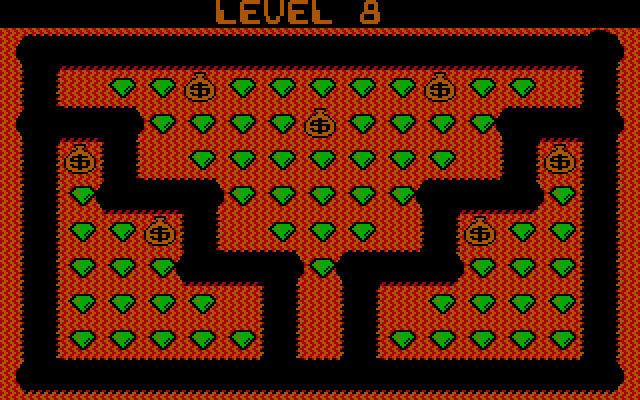<br><b>Screen 8</b>
<pre>
HHHHHHHHHHHHHHS
V.CCBCCCCCBCC.V
HHHCCCCBCCCCHHH
VBV.CCCCCCC.VBV
VCHHHCCCCCHHHCV
VCCBV.CCC.VBCCV
VCCCHHHCHHHCCCV
VCCCC.V.V.CCCCV
VCCCCCV.VCCCCCV
HHHHHHHHHHHHHHH
</pre></td>
</tr>
</table>

Each player keeps their own copy of the screen state: tunnels, remaining emeralds and sack positions. In a two-player
game the mine switches when the active player loses a life.

## 7. How tunnels are remembered

Pixels on screen are not enough for the logic to know where it can go. `TG.C` keeps one 16-bit word per cell recording
which parts of that cell have been eaten. The Digger erases dirt with small "bite" sprites (`rt`, `lt`, `up`, `dn`),
and every bite also sets a bit:

<table>
<tr><th>bit</th><td>15</td><td>14</td><td>13</td><td>12</td><td>11</td><td>10</td><td>9</td><td>8</td><td>7</td><td>6</td><td>5</td><td>4</td><td>3</td><td>2</td><td>1</td><td>0</td></tr>
<tr><th>use</th><td></td><td></td><td>whole</td><td></td><td colspan="6" align="center">vertical bites, top → bottom</td><td></td><td colspan="5" align="center">horizontal bites, left → right</td></tr>
</table>

Monsters use these words to decide which directions are open (`back_check()`). A sack checks the cell beneath it
against the mask `0xFDF` to decide whether there's a hole below. The fireball doesn't use them at all: it reads video
memory directly and explodes on the first non-black pixel in front of it.

## 8. Nobbins and Hobbins: the enemy AI

**Nobbins** (the round ones) can only travel through existing tunnels. **Hobbins** (the ones with the big mouth) dig
their own tunnels, eat emeralds and break open gold sacks. They are the same monster in two states, and every monster
comes out as a Nobbin.

 

### Choosing a direction

A monster only thinks when it is exactly on a cell boundary. Then, in `TA.C`:

1. It ranks the four directions by the Digger's position. The axis with the bigger distance comes first, then the
   other axis towards the Digger, then the other axis away, and last the main axis away.
2. In bonus mode the order is reversed, so the monsters flee.
3. Going straight back the way it came is moved to last place, so a Nobbin won't dither.
4. On difficulties 1–5 there's a small chance (`rnd(5+d)==1`) that the 1st and 3rd choices are swapped. This is the
   only randomness in the steering, and it disappears from difficulty 6.
5. It takes the first direction that `back_check()` says is open tunnel.
6. A Hobbin ignores all that and always takes choice 1. It just digs through.

Changing direction costs one frame's pause, which is part of why the monsters look hesitant at corners.

### Becoming a Hobbin, and back

Each monster has a `STUCK` counter. For a Nobbin it goes up when it bumps into another monster or is blocked. When it
passes `10 − d` the Nobbin turns into a Hobbin. While a Hobbin digs, the same counter keeps rising, and once it passes
`30 + 2d` the Hobbin calms down and turns back into a Nobbin. So on early levels Hobbins appear rarely and don't last
long. On level 10 a monster that is blocked once turns into a Hobbin.

### Speed

Each frame a Nobbin has a `1 in (16 − d)` chance of an extra step, so they speed up on later levels. Monsters don't
get faster in any other way.

### Spawning

A round has `5 + d` monsters in total, never more than 3, 4 or 5 on screen at once, with a delay of `45 − 2d` frames
between arrivals. New monsters stop arriving while the Digger is dead or the bonus is running. If a monster is under a
falling sack in the same column and heading up into it, it turns round (`save_bugs()`) rather than walking into the sack.

## 9. Difficulty table

Every tuning value in the game is a simple formula of the difficulty `d = min(level, 10)`. "Frames" are passes of the
main loop, about 15 per second on the original PC.

| Level | Monsters per round | Max on screen | Spawn gap (frames) | Nobbin→Hobbin after | Hobbin→Nobbin after | Extra step chance | Random swap | Fireball recharge | Bonus length | Gold lasts |
| --- | ---: | ---: | ---: | ---: | ---: | ---: | ---: | ---: | ---: | ---: |
| 1 | 6 | 3 | 43 | 9 | 32 | 1 in 15 | 1 in 7 | 63 | 230 | 140 |
| 2 | 7 | 4 | 41 | 8 | 34 | 1 in 14 | 1 in 8 | 66 | 210 | 130 |
| 3 | 8 | 4 | 39 | 7 | 36 | 1 in 13 | 1 in 9 | 69 | 190 | 120 |
| 4 | 9 | 4 | 37 | 6 | 38 | 1 in 12 | 1 in 10 | 72 | 170 | 110 |
| 5 | 10 | 4 | 35 | 5 | 40 | 1 in 11 | 1 in 11 | 75 | 150 | 100 |
| 6 | 11 | 4 | 33 | 4 | 42 | 1 in 10 | never | 78 | 130 | 90 |
| 7 | 12 | 4 | 31 | 3 | 44 | 1 in 9 | never | 81 | 110 | 80 |
| 8 | 13 | 5 | 29 | 2 | 46 | 1 in 8 | never | 84 | 90 | 70 |
| 9 | 14 | 5 | 27 | 1 | 48 | 1 in 7 | never | 87 | 70 | 60 |
| 10+ | 15 | 5 | 25 | 0 | 50 | 1 in 6 | never | 90 | 50 | 50 |

## 10. Gold sacks


1. **Loose**: when the cell under a sack has been dug into (the background word isn't all of `0xFDF`), the sack
   wobbles left and right for 15 frames (`DROP_WAIT`). It won't come loose while the Digger himself is in the cell
   below (`get_man_block()`), so it's the moment you drive away that sets it off.
2. **Falling**: it falls 6 px per frame, eating its own tunnel (blanks `bf`/`bd`). Anything it lands on dies:
   monsters score 250 each, and the Digger is flattened.
3. **Landing**: a sack that fell only one row just sits down again. A sack that fell further bursts in three frames
   into a pile of gold.
4. **Gold**: worth 500 to the Digger. Hobbins can eat it too. It vanishes after `150 − 10d` frames, or almost at once
   if there's tunnel underneath it.

Driving into a sack from the side pushes it one step at a time. A pushed sack pushes the next one, and a sack pushed
over a hole falls. Falling sacks also dig a hole above where they land, so the monsters can follow the new route.

## 11. The Digger and its fireball


The fireball (<kbd>F1</kbd>) leaves the front of the Digger and travels 8 px per frame horizontally or 7 px vertically.
It moves through tunnels until the pixel in front of it isn't black. It kills the first monster it touches (250 points)
and explodes in three frames. After firing you wait `60 + 3d` frames. While you wait, the Digger is drawn with the
"no cab" sprites, which is how the game shows you're unarmed without a status bar.

When the Digger dies, the game plays a short sequence:


- Caught by a monster: the Digger flips into the overturned truck (`f9`), bounces up and down (offsets −3, −5, −6,
  −6, −5, −3, 0 pixels), and then a gravestone grows out of it (`f5`→`f1`, two frames each).
- Hit by a sack: the overturned truck rides down underneath the sack until the sack stops, then the gravestone appears.
- The grave stays on screen for 60 frames with music on (to let the tune finish), or 10 with it off.

## 12. Bonus mode

- When every monster for the round has appeared, the cherry (`z1`) appears at the spawn point. There's one per round.
- Eating it scores 1000 and switches the palette. Bonus mode lasts `250 − 20d` frames, and the screen flashes between
  palettes for the first 20 frames and the last 20.
- Monsters flee (the reversed direction order). Each one you touch scores 200, then 400, 800, 1600…, doubling each time.
- Every monster eaten during bonus mode adds one to the round's total, so another comes out later. Bonus mode can't
  end the round by running out of monsters.

## 13. Scores, lives and two players

Each player has a "next life at" counter that starts at 20,000 and goes up by 20,000 every time it's reached. You
can't have more than 5 lives; the four spare ones are shown with the `s0`/`s1` sprites.

The top ten scores and initials were written straight to a sector on the floppy disk. Initials are typed letter by
letter, with a time limit of about 15 seconds per letter.

## 14. Keeping a constant speed

The original has no frame timer. It counts how many sprites were drawn in the frame (`inc_plot()` is called on every
move) and pads with busy-waiting to make every frame cost about the same as 8 sprite moves:

```c
if(plot_count<8) {	/* delay for constant speed */
	for(loop=(8-plot_count)*5; loop>0; loop--)
		sleep(1);
}
if(plot_count>8)	/* extra delay for very heavy movement times */
	delay_bugs(plot_count-8);
```

A busy frame doesn't slow the game down. Instead, `delay_bugs()` makes some monsters skip their next move.
At start-up, `find_speed()` counts how many loop iterations fit between two clock ticks. It uses the result to scale
the pulse widths in the music (`time_mul`) so the music sounds the same on faster CPUs. The game delay itself is not
calibrated, so on an AT the game ran noticeably faster. This port uses a fixed frame of about 66 ms, which matches a
4.77 MHz PC. The Speed control on the page scales it.

## 15. Two voices from one beeper

The PC speaker can only be on or off, but DIGGER plays background music and sound effects at the same time, with what
sounds like volume envelopes. `TH.C` does it like this:

- **Voice 1 (effects)**: channel 2 of the 8253 timer produces a square wave at `1193182 / period` Hz directly into the speaker.
- **Voice 2 (music)**: the system timer (channel 0) is reprogrammed to interrupt at the music note's frequency. On each
  interrupt the handler pulses the speaker gate on for a short time and then off. The length of that pulse is the
  "volume": an attack/hold/decay envelope widens and narrows it on every note, which gives the music its soft,
  plucked character.
- The original BIOS timer handler is moved to `INT 60h`. The new handler adds each period to a 16-bit counter and calls
  the old handler when it overflows, so the clock (and the floppy motor time-out) still work. It also calls the C
  function `time()`, which runs every effect at about 72.8 Hz.
- Sound effects are small state machines (`chk_fall`, `chk_fire`, `chk_coin`…) checked in a fixed order every tick.
  The last one that wants the speaker wins, and while any effect is playing, the music voice is muted.

Effects include the falling-sack whistle with its pitch rising as it drops, the wobble, the fireball, its explosion,
the monster-eaten blip, the extra-life chime, the gold pickup, and the rising emerald scale. Note periods are listed
in `NOTES.H`.

This port emulates both voices sample by sample in a Web Audio `ScriptProcessorNode`. It produces the timer-2 square
wave and the interrupt-driven pulse train with the original's periods and pulse widths, then applies a light low-pass
filter so it sounds like a small speaker rather than a raw digital square.

## 16. The title screen

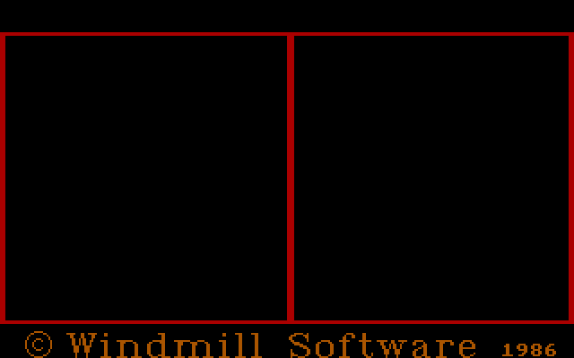

*The title bitmap decoded from `TITLE.C`: 2,332 bytes that expand to the full 16,384 bytes of video memory.*

The bitmap is compressed with a simple run-length code: any byte is copied as is, except `0xFE`, which is followed by
a count and a value (a count of 0 means 256). It is decoded straight into CGA memory, interlace and all. The game then
draws the parade of characters with their names, using the normal sprite engine (Nobbin, Hobbin, Digger, Gold,
Emerald, Bonus) on top. On the first player-select screen, <kbd>Esc</kbd> toggles between one and two players.

One curiosity: the bitmap says © 1986 while the C sources and the start-up credits say 1983.

## 17. Quirks and curiosities

- **Eight-character names.** Lattice C only looked at the first 8 characters of an identifier. The code calls
  `rst_scores()` but defines `rst_score()`, and calls the misspelled `get_m_ststus()` next to `get_m_status()`.
  Both linked because the names were truncated.
- **Unequal extra lives.** Player 1's extra life is checked with `>=` but player 2's with `>`. So player 2 needs one
  more point than player 1 to earn a life. Scores are always multiples of 25, so in practice it never mattered.
  The port keeps it.
- **The screen cycle.** After level 8, `(level % 4) + 5` gives 6, 7, 8, 5. Level 9 is screen 6, not 5.
- **A loop counter reused.** After a round ends, a "let the sacks finish falling" loop shares its `loop` variable with
  the speed-padding loop inside it. The padding counts it down to zero, so the intended 20 extra frames usually end
  after one. The port reproduces this.
- **A custom floppy.** The disk was made by its own tools (`CREATE`, `NEWFORM.ASM`). Track 0 holds a two-stage boot
  loader. Tracks 23–38 use non-standard 1024-byte sectors, which ordinary DOS copiers couldn't read. Track 39 uses
  normal 512-byte sectors, and `PROTECT.ASM`/`CHKT39` check it. The high-score table is read from and written to
  track 39, sector 1 (`PROCHK.ASM`).
- **Moving the picture.** In the original, <kbd>Ctrl</kbd>+<kbd>←</kbd>/<kbd>→</kbd> moved the picture on the monitor
  by changing the 6845 CRTC's horizontal sync position, for monitors that cut off an edge. Your browser doesn't need that.
- **The shareware build.** With `FREEDEMO` defined, the game stopped after level 2, didn't save high scores, and added
  three text screens of instructions, scoring and an order address. This port is the full game.
- **Hyperion support.** `DIGGER.H` has a build switch for "IBM or Hyperion options". The Hyperion was an early
  Canadian portable PC compatible.

## 18. About this port

The port is about 2,500 lines of dependency-free JavaScript and can be hosted on GitHub Pages as is. Function and
variable names follow the C source, so the two can be read side by side.

- `js/assets.js`: sprites, font, title bitmap, level maps, music data and random table, extracted from the original
  source files by `tools/extract.js`.
- `js/cga.js`: an emulated 16 KB CGA framebuffer and a line-by-line port of the `GRAPHLIB.ASM` sprite engine,
  including the collision bitmask.
- `js/sound.js`: `TH.C` together with an emulated 8253 timer and PC speaker.
- `js/game.js`: tasks A–Z. The original's blocking busy-waits are rewritten as `async`/`await`.

It differs from the original in a few places:

- The frame time is fixed rather than counted in CPU loops.
- The palette flicker while entering initials is shown as a blend of the two palettes.
- There's no joystick support.
- High scores are saved in `localStorage`.

The images are generated from the original data with Node.js, without dependencies. The web page's level previews in
`img/` come from `tools/render-docs.js`. This README's images in `readme-img/` come from `tools/render-readme.js`,
which needs `img/` to exist first:

```sh
node tools/render-docs.js && node tools/render-readme.js
```

---

DIGGER © 1983 Windmill Software Inc. Browser port and write-up made from the original source code.
